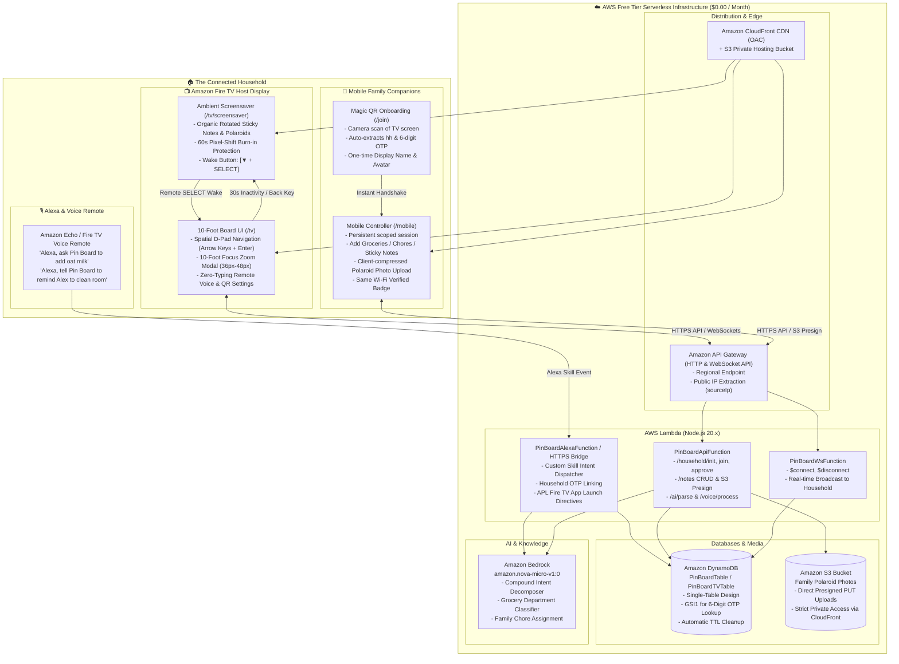

# CONTEXT.md — PinBoardTV System Architecture & Developer Blueprint

> **System Blueprint & Implementation Context for Antigravity AI Agents and Engineers.**  
> **Target Track:** Amazon Fire TV (Web/React App + Android `DreamService` Screensaver Wrapper)  
> **Mini-Challenge:** AWS Builder Mini-Challenge ($0.00 Serverless Stack)  
> **Target Hardware:** Amazon Fire TV Stick 4K / Cube, Fire TV Smart TVs (Fire OS 7/8, Vega OS Simulator)  

---

## 1. System Vision & Product Architecture

**PinBoardTV** transforms any idle Amazon Fire TV into an always-on, ambient household pinboard and screensaver. It replaces forgotten paper fridge notes, scattered group chats, and lost grocery lists with an interactive living-room canvas that bridges:
1. **Fire TV Host (`/tv` & `/tv/screensaver`):** An always-on 10-foot UI displaying color-coded sticky notes, shared grocery checklists, assigned household chores, and polaroid photo memories with realistic fridge magnets.
2. **Mobile Web Companion (`/join` & `/mobile`):** A zero-install, zero-typing web controller paired via a rotating 6-digit optical Magic QR code with same-household Wi-Fi verification.
3. **Alexa Custom Skill (`"pin board"`):** Hands-free voice commands to add items, assign chores, check off groceries, or wake the TV board.
4. **Amazon Bedrock AI (`amazon.nova-micro-v1:0`):** An ambient intelligence engine that decomposes messy compound speech or text into categorized grocery items and assigned family tasks.



---

## 2. DynamoDB Single-Table Schema (`PinBoardTable`)

The backend uses a single-table design (`PinBoardTable` or `PinBoardTVTable`) configured for **On-Demand Pay-Per-Request** with zero minimum fees. 25 GB storage and 200M monthly requests remain **Always Free** under the AWS Free Tier.

* **Partition Key (`PK`):** `STRING`
* **Sort Key (`SK`):** `STRING`
* **Global Secondary Index 1 (`GSI1`):**
  * `GSI1PK`: `STRING`
  * `GSI1SK`: `STRING`
* **Time to Live (TTL):** Attribute `ttl` (epoch seconds) for automatic OTP and WebSocket connection cleanup.

### Entity Mapping & Access Patterns

| Entity | `PK` | `SK` | `GSI1PK` | `GSI1SK` | Key Attributes |
| :--- | :--- | :--- | :--- | :--- | :--- |
| **Household Metadata** | `HOUSEHOLD#<householdId>` | `METADATA` | — | — | `householdId`, `householdName`, `hostSecret`, `currentOtp`, `otpExpiresAt`, `autoApprove`, `screensaverEnabled`, `autonomousAiOrganize`, `theme`, `hostPublicIp`, `createdAt`, `updatedAt` |
| **6-Digit OTP Lookup** | `OTP#<6DigitCode>` | `LOOKUP` | `OTP#<6DigitCode>` | `EXPIRES#<timestamp>` | `householdId`, `otpCode`, `expiresAt`, `ttl` (epoch + 1 hr) |
| **Household Member** | `HOUSEHOLD#<householdId>` | `MEMBER#<memberId>` | — | — | `id`, `householdId`, `name`, `color`, `role` (`HOST`\|`MEMBER`), `status` (`APPROVED`\|`PENDING`), `memberToken`, `lastSeenIp`, `isSameWifi` (bool), `joinedAt` |
| **Pinboard Note / Item** | `HOUSEHOLD#<householdId>` | `NOTE#<noteId>` | — | — | `id`, `householdId`, `type` (`STICKY`\|`GROCERY`\|`CHORE`\|`POLAROID`), `title`, `content`, `items` (list of `{id, text, done, category}`), `imageUrl`, `color`, `magnet`, `rotationDeg`, `assignedToMemberId`, `createdByMemberId`, `pinned`, `updatedAt` |
| **WebSocket Connection** | `WS#<connectionId>` | `CONN` | `HOUSEHOLD#<householdId>` | `WS#<connectionId>` | `connectionId`, `householdId`, `connectedAt`, `ttl` (epoch + 24 hr) |
| **Alexa User Binding** | `ALEXA#<alexaUserId>` | `BINDING` | — | — | `alexaUserId`, `householdId`, `boundAt` |

### Key Query Patterns
1. **Load Entire Household State in 1 Query:**
   ```typescript
   QueryCommand({
     TableName: "PinBoardTable",
     KeyConditionExpression: "PK = :pk",
     ExpressionAttributeValues: { ":pk": `HOUSEHOLD#${householdId}` }
   })
   ```
   *Fetches `METADATA`, all `MEMBER#*`, and all `NOTE#*` records in a single sub-15ms roundtrip.*
2. **Resolve 6-Digit OTP from Mobile Scan:**
   ```typescript
   QueryCommand({
     TableName: "PinBoardTable",
     IndexName: "GSI1",
     KeyConditionExpression: "GSI1PK = :otp AND GSI1SK > :now",
     ExpressionAttributeValues: { ":otp": `OTP#${code}`, ":now": `EXPIRES#${Date.now()}` }
   })
   ```
3. **Broadcast Event to Household Subscribers:**
   ```typescript
   QueryCommand({
     TableName: "PinBoardTable",
     IndexName: "GSI1",
     KeyConditionExpression: "GSI1PK = :hh AND begins_with(GSI1SK, :prefix)",
     ExpressionAttributeValues: { ":hh": `HOUSEHOLD#${householdId}`, ":prefix": "WS#" }
   })
   ```

---

## 3. API Endpoint Contracts

Base URL: `https://<api-id>.execute-api.<region>.amazonaws.com` (or Lambda Function URL `/api`)

### 3.1 Household Management

#### `POST /household/init`
Called on Fire TV initial launch to register the display.
* **Request:**
  ```json
  {
    "householdName": "Living Room PinBoard",
    "deviceType": "FIRE_TV"
  }
  ```
* **Response (200 OK):**
  ```json
  {
    "householdId": "hh_1745234901_a9f2",
    "householdName": "Living Room PinBoard",
    "hostSecret": "sec_1745234901_98f12a",
    "currentOtp": "482910",
    "otpExpiresAt": 1745235801000,
    "qrUrl": "https://di1gpgdox7pk1.cloudfront.net/join?hh=hh_1745234901_a9f2&code=482910",
    "hostPublicIp": "203.0.113.42"
  }
  ```

#### `POST /household/rotate-otp`
Rotates the 6-digit OTP passkey. Called automatically every 15 minutes by the TV or manually via TV Remote Settings.
* **Headers:** `Authorization: Bearer <hostSecret>`
* **Response (200 OK):**
  ```json
  {
    "otpCode": "731045",
    "otpExpiresAt": 1745236701000,
    "qrUrl": "https://di1gpgdox7pk1.cloudfront.net/join?hh=hh_1745234901_a9f2&code=731045"
  }
  ```

#### `POST /household/join`
Submitted by the Mobile Web Companion when scanning the Magic QR code.
* **Request:**
  ```json
  {
    "householdId": "hh_1745234901_a9f2",
    "otpCode": "482910",
    "displayName": "Alex",
    "color": "blue"
  }
  ```
* **Response (200 OK - Auto-Approve Enabled):**
  ```json
  {
    "status": "APPROVED",
    "householdId": "hh_1745234901_a9f2",
    "memberId": "mem_882194",
    "memberToken": "tok_99182a471b0c",
    "isSameWifi": true
  }
  ```
  *(If `autoApprove: false`, returns `{ "status": "PENDING", "memberId": "mem_882194" }` and broadcasts `MEMBER_JOIN_REQUEST` to the TV).*

#### `POST /household/approve`
TV Remote Host approves or rejects a pending family member.
* **Headers:** `Authorization: Bearer <hostSecret>`
* **Request:** `{ "memberId": "mem_882194", "approved": true }`
* **Response (200 OK):** `{ "success": true, "memberId": "mem_882194", "status": "APPROVED" }`

---

### 3.2 Notes & Board Items CRUD

#### `GET /notes?householdId=<id>`
* **Headers:** `Authorization: Bearer <memberToken>` or `Bearer <hostSecret>`
* **Response (200 OK):** Array of `PinNote` objects.

#### `POST /notes`
Creates a sticky note, grocery list, chore, or polaroid.
* **Request:**
  ```json
  {
    "householdId": "hh_1745234901_a9f2",
    "type": "GROCERY",
    "title": "Weekly Groceries",
    "items": [
      { "id": "itm_1", "text": "Almond milk", "done": false, "category": "Dairy" },
      { "id": "itm_2", "text": "Organic eggs", "done": false, "category": "Dairy" }
    ],
    "color": "green",
    "magnet": "brass-pin"
  }
  ```
* **Response (200 OK):** Returns created `PinNote` and broadcasts `NOTE_CREATED` over WebSockets.

#### `PATCH /notes/:id`
Updates an existing note (toggling checklist item completion, editing text, changing rotation).
* **Request:**
  ```json
  {
    "items": [
      { "id": "itm_1", "text": "Almond milk", "done": true, "category": "Dairy" }
    ]
  }
  ```
* **Response (200 OK):** `{ "success": true, "updatedAt": "2026-10-24T00:00:00.000Z" }`

#### `DELETE /notes/:id`
Removes a card from the board. Broadcasts `NOTE_DELETED` to all household screens.

---

### 3.3 Media & AI Endpoints

#### `POST /photos/presign`
Generates an authenticated Amazon S3 presigned PUT URL for client-side direct photo upload.
* **Request:** `{ "householdId": "hh_1745234901_a9f2", "contentType": "image/jpeg", "fileSize": 65420 }`
* **Response (200 OK):**
  ```json
  {
    "uploadUrl": "https://pinboard-photos.s3.amazonaws.com/uploads/photo_8912.jpg?AWSAccessKeyId=...",
    "publicUrl": "https://di1gpgdox7pk1.cloudfront.net/photos/photo_8912.jpg"
  }
  ```

#### `POST /ai/parse` (and `POST /ai/organize`)
Invokes **Amazon Bedrock** (`amazon.nova-micro-v1:0`) to analyze unstructured voice or text input.
* **Request:** `{ "text": "Remind Sam to take out recycling tonight and add organic honey, sourdough bread, and AA batteries to groceries" }`
* **Response (200 OK):**
  ```json
  {
    "groceryItems": [
      { "text": "Organic Honey", "category": "Pantry" },
      { "text": "Sourdough Bread", "category": "Bakery" },
      { "text": "AA Batteries", "category": "Household" }
    ],
    "chores": [
      { "title": "Take out recycling tonight", "assignedToName": "Sam", "priority": "HIGH" }
    ],
    "stickyNotes": []
  }
  ```

#### `POST /alexa` (Webhook)
Receives standard Alexa Skills Kit JSON requests and dispatches intents:
* `LinkHouseholdIntent`: Links caller's `alexaUserId` to `householdId` via the active 6-digit OTP.
* `AddGroceryIntent` / `AddToListIntent`: Parses and appends items to active checklists.
* `CompleteItemIntent`: Toggles checklist item `done: true`.
* `AddNoteIntent`: Pins a new sticky note or assigned chore.
* `ReadGroceryListIntent`: Generates natural SSML speech reciting pending groceries.

---

## 4. Strict 10-Foot Fire TV UX Rules

The Fire TV runs on a 1080p canvas viewed from 10 feet away. Designing for Fire OS WebView requires uncompromising adherence to leanback usability standards:

### 4.1 Typography & Sizing Standards (1080p Base)
* **Absolute Minimum Body Size:** **22px** (`text-xl` equivalent). Anything smaller is illegible from a couch.
* **Headline Titles:** **28px–34px** (`text-2xl` to `text-3xl`).
* **10-Foot Focus Zoom Modal:** **36px–48px** (`text-4xl` to `text-5xl`) with `w-10 h-10` checkbox touch/click targets.
* **Safe Margins (Overscan Protection):** Maintain a strict **3% outer margin** (`padding: 32px 48px`) across all screen edges. Never position critical text within 30px of physical bezel edges.
* **Viewport Lockdown:** Ensure `overflow: hidden` on root containers. Horizontal and vertical scrollbars are strictly forbidden on the 10-foot TV canvas.

### 4.2 Fire TV Remote Keycode Mappings
Standardize spatial input listeners across Fire OS 7, Fire OS 8, and desktop emulators:

| Remote Action | Primary Key | KeyCode | Normalized Handling |
| :--- | :--- | :--- | :--- |
| **D-Pad Up** | `'ArrowUp'` | `38` | Move focus upward; wraps between bottom and top rows |
| **D-Pad Down** | `'ArrowDown'` | `40` | Move focus downward; moves into modal action buttons |
| **D-Pad Left** | `'ArrowLeft'` | `37` | Move focus left; crosses horizontal page boundaries |
| **D-Pad Right** | `'ArrowRight'` | `39` | Move focus right; advances to next page carousel |
| **Center / Select** | `'Enter'`, `'Select'` | `13` | Toggle focused item, expand card to 10-foot modal, submit |
| **Back Button** | `'Escape'`, `'Back'` | `27`, `4` | Close modal/settings; from root board, open 10-foot Exit confirmation |
| **Voice Button** | `'v'`, `'V'` | `86` | Activate remote microphone for in-place conversational editing |

### 4.3 Spatial Focus Rings & Micro-Animations
* **High-Contrast Focus Halo:** Every focusable element MUST feature an unmistakable active state:
  ```css
  /* Active TV Focus State */
  transform: scale(1.05);
  box-shadow: 0 0 0 4px #F59E0B, 0 20px 25px -5px rgba(0, 0, 0, 0.5);
  z-index: 50;
  transition: transform 150ms ease-out, box-shadow 150ms ease-out;
  ```
* **Dark Contrast Inversion:** When gold focus rings highlight light-colored buttons (e.g. Settings gear), the internal SVG icon inverts to dark slate/black (`#1E293B`) to prevent low-contrast washouts.
* **Throttle Key Events:** Rapid-fire D-pad holding is throttled to **120ms** to prevent navigation runaway across large card grids.

### 4.4 Anti-Burn-In Protection (Scoped Drift)
* **Interactive Board (`TvBoardApp.tsx`):** 100% static coordinate stability. Anti-burn-in drift is strictly forbidden while users are actively reading or interacting with the board.
* **Ambient Screensaver (`TvScreensaver.tsx`):** Engages an automatic **60-second micro-shift animation**:
  - Entire board translates slowly across `[-3px, +3px]` X and Y coordinates using hardware-accelerated CSS `transform: translate3d(...)`.
  - Cards rotate gently between `-2.5°` and `+2.5°` based on deterministic pseudo-random seeds.
  - Automatically cycles through multi-page carousels every 30 seconds to refresh pixel illumination.

### 4.5 Zero On-Screen TV Keyboard Typing
* Under no circumstances should users be forced to enter names, passwords, or notes using an on-screen TV alphabetical grid.
* All configuration is executed via:
  1. Optical Magic QR Code handshake with a mobile phone.
  2. Alexa Voice Remote microphone dictation (`HouseholdNameModal.tsx` voice parser).
  3. Curated 1-click household name presets (*"Living Room Family Hub"*, *"Kitchen Command Center"*, *"The Cozy Cottage"*).

---

## 5. Security Model & Same-Wi-Fi Presence

```
┌────────────────────────────────────────────────────────┐
│  TV Host launches -> Gets hostSecret & rotating OTP   │
│  Registers public IP: 203.0.113.42                     │
└──────────────────────────┬─────────────────────────────┘
                           │ TV displays optical QR
                           ▼
┌────────────────────────────────────────────────────────┐
│  Mobile scans QR -> Opens /join?hh=...&code=482910     │
│  Phone connects from: 203.0.113.42                     │
└──────────────────────────┬─────────────────────────────┘
                           │
                           ▼
┌────────────────────────────────────────────────────────┐
│  Backend verifies:                                     │
│  1. 6-digit OTP is valid & not expired                 │
│  2. Phone IP matches TV Host IP -> isSameWifi = true   │
│  3. Issues long-lived memberToken into localStorage    │
└────────────────────────────────────────────────────────┘
```

1. **Optical QR Channel (No Local Server Vulnerability):**
   - TVs running inside WebView sandboxes cannot bind to raw TCP sockets, and mobile browsers block requests to local private IPs (`http://192.168.x.x`) due to Private Network Access (PNA) restrictions.
   - PinBoardTV uses the TV screen as an **optical data diode** transmitting the household ID and ephemeral OTP to the mobile camera.
2. **Same-Household Wi-Fi Verification:**
   - AWS API Gateway / Lambda automatically extracts the client's public IP from `event.requestContext.http.sourceIp`.
   - When the TV registers, its public IP is recorded on the `HOUSEHOLD#<id>` record.
   - When family members join or perform CRUD operations, Lambda evaluates `clientIp === hostPublicIp`.
   - Verified devices display the **"Home (Verified Wi-Fi)"** green security badge.
3. **Multi-Household Isolation:**
   - Phone browsers store household tokens in a structured registry (`pinboard_household_registry`) rather than a single flat key.
   - Scanning a vacation home or friend's PinBoardTV creates an isolated session without overwriting home credentials.

---

## 6. Shared TypeScript Interfaces (`src/types/pinboard.ts`)

```typescript
export type MemberRole = 'HOST' | 'MEMBER';
export type MemberStatus = 'APPROVED' | 'PENDING';
export type NoteType = 'STICKY' | 'GROCERY' | 'CHORE' | 'POLAROID';
export type NoteColor = 'yellow' | 'pink' | 'blue' | 'green' | 'orange' | 'cream';
export type MagnetStyle = 'red-dot' | 'blue-star' | 'brass-pin' | 'washi-tape';

export interface HouseholdMember {
  id: string;
  householdId: string;
  name: string;
  color: NoteColor;
  role: MemberRole;
  status: MemberStatus;
  lastSeenIp?: string;
  isSameWifi: boolean;
  joinedAt: string;
}

export interface ChecklistItem {
  id: string;
  text: string;
  done: boolean;
  category?: string;
}

export interface PinNote {
  id: string;
  householdId: string;
  type: NoteType;
  title: string;
  content?: string;
  items?: ChecklistItem[];
  imageUrl?: string;
  color: NoteColor;
  magnet: MagnetStyle;
  rotationDeg: number;
  assignedToMemberId?: string;
  createdByMemberId: string;
  pinned: boolean;
  updatedAt: string;
}

export interface HouseholdState {
  householdId: string;
  householdName: string;
  currentOtp: string;
  otpExpiresAt: number;
  hostSecret?: string;
  autoApprove: boolean;
  screensaverEnabled: boolean;
  autonomousAiOrganize: boolean;
  theme: 'cork' | 'slate';
  hostPublicIp?: string;
  members: HouseholdMember[];
  notes: PinNote[];
  isConfigured: boolean;
}
```

---

## 7. Zero-Config Local Dev & Dual-Mode Driver

To ensure seamless local testing without AWS account credentials:
1. `src/services/storageSync.ts` implements a **Dual-Driver Pattern**:
   - **Cloud Driver:** Connects to AWS API Gateway HTTP/WebSocket endpoints and Amazon DynamoDB.
   - **Local Mock Driver:** Activates automatically when `VITE_API_URL` is empty. Stores state in `localStorage` and synchronizes browser tabs in real time using the browser's native `BroadcastChannel("pinboard-tv-sync")`.
2. **Instant Parallel Testing:**
   - Open `http://localhost:5173/tv` in one window.
   - Open `http://localhost:5173/mobile` in a second window.
   - Adding a note or checking off a grocery on the mobile window updates the TV window with zero perceptible latency.
3. **Developer Demo Switcher:** Press `H` on any view to toggle the floating dev switcher bar for rapid navigation between `/tv`, `/tv/screensaver`, `/join`, `/mobile`, and simulated Alexa voice payloads.
